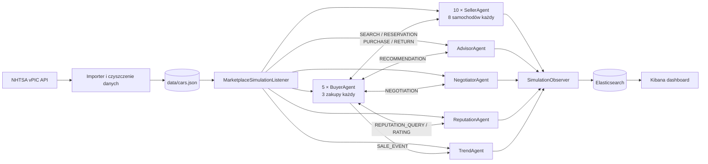

# Sprawozdanie — wieloagentowa giełda samochodowa

## 1. Wprowadzenie

Celem projektu jest symulacja giełdy samochodowej z użyciem Java, JADE/ACL,
Elasticsearch i Kibana. Niezależni agenci reprezentują kupujących, sprzedających
oraz usługi doradcze. System pobiera rzeczywiste dane identyfikacyjne pojazdów z
NHTSA vPIC, uzupełnia brakujące dane rynkowe w sposób deterministyczny i wykonuje
pełną symulację dla 10 sprzedających, 5 kupujących i 80 samochodów.

Zakres obejmuje wyszukiwanie ofert, kontrolę budżetu, konkurencję, rezerwacje,
negocjacje, rekomendacje TOP 3 metodą MCDA, reputację, analizę trendów, zwroty,
wycenę rynkową oraz zapis wyników w Elasticsearch.

## 2. Architektura systemu



`SellerInventory` jest autorytatywnym właścicielem stanu pojazdów. Metody
rezerwacji, zakupu, wygaśnięcia i zwrotu są synchronizowane, dlatego jeden pojazd
nie może zostać jednocześnie zarezerwowany lub sprzedany dwóm kupującym.
`SimulationObserver` zbiera wyniki i przekazuje transakcje do opcjonalnego
`MarketplaceEventSink` implementowanego przez Elasticsearch.

## 3. Opis agentów

| Agent | Liczba | Dane wejściowe | Dane wyjściowe i decyzje |
|---|---:|---|---|
| `SellerAgent` | 10 | kryteria, identyfikator auta, kupujący, uzgodniona cena, identyfikator transakcji | najlepsza dostępna oferta albo brak oferty; akceptacja/odrzucenie rezerwacji, zakupu i zwrotu |
| `BuyerAgent` | 5 | budżet, preferencje, odpowiedzi pozostałych agentów | zapytania ACL, wybór oferty, płatność, ocena sprzedawcy; kończy po 3 zachowanych zakupach |
| `AdvisorAgent` | 1 | oferty, kryteria i reputacje | TOP 3 według MCDA oraz wycena pierwszej oferty |
| `NegotiatorAgent` | 1 | oferta katalogowa, pierwsza oferta kupującego i jego limit | akceptacja, kontrpropozycje lub odrzucenie, maksymalnie 3 rundy i 15% rabatu |
| `ReputationAgent` | 1 | zapytania o reputację i oceny 1–5 | średnia oraz liczba ocen; odrzuca ponowną ocenę tej samej transakcji |
| `TrendAgent` | 1 | potwierdzone zdarzenia sprzedaży | popularne nadwozie, model i paliwo, średnia cena oraz trend ceny |

Agenci usługowi rejestrują się w JADE Directory Facilitator. Kupujący odkrywa
ich dynamicznie i rozpoczyna pracę dopiero po znalezieniu wszystkich wymaganych
usług.

## 4. Komunikacja JADE/ACL

Treść komunikatów jest kodowana jako JSON, natomiast typ operacji określa pole
`ontology`. Każda faza używa `conversationId`, `replyWith` i `inReplyTo`, dzięki
czemu kupujący przyjmuje wyłącznie odpowiedź z właściwej rozmowy i od właściwego
agenta.

| Ontologia | Nadawca → odbiorca | Performatywy | Znaczenie |
|---|---|---|---|
| `car-search` | Buyer → Seller | `CFP`, `PROPOSE` / `REFUSE` | wyszukanie najlepszej dostępnej oferty |
| `reputation-query` | Buyer → Reputation | `QUERY_REF`, `INFORM` | pobranie reputacji sprzedających |
| `car-recommendation` | Buyer → Advisor | `REQUEST`, `INFORM` | TOP 3, wynik MCDA i wycena |
| `car-negotiation` | Buyer → Negotiator | `REQUEST`, `INFORM` | negocjacja ograniczona do 3 rund |
| `car-reservation` | Buyer → Seller | `REQUEST`, `AGREE` / `REFUSE` | czasowa rezerwacja uzgodnionej ceny |
| `car-purchase` | Buyer → Seller | `REQUEST`, `INFORM` / `FAILURE` | finalizacja sprzedaży |
| `seller-rating` | Buyer → Reputation | `INFORM`, `INFORM` / `FAILURE` | pojedyncza ocena potwierdzonej transakcji |
| `market-sale-event` | Buyer → Trend | `INFORM`, `INFORM` / `FAILURE` | analiza zachowanej sprzedaży |
| `car-return` | Buyer → Seller | `REQUEST`, `INFORM` / `REFUSE` | zwrot w dozwolonym oknie czasu |

Przykładowa treść rezerwacji:

```json
{
  "carId": "CAR-062",
  "buyerName": "Buyer01",
  "agreedTotalPln": 124590
}
```

Sprzedający dodatkowo porównuje `buyerName` z tożsamością nadawcy ACL i
samodzielnie sprawdza minimalną cenę, dostępność oraz właściciela rezerwacji.

## 5. Najważniejsze elementy implementacji

### Dane

Importer odrzuca niepełne rekordy i duplikaty. Rzeczywiste pola producenta,
modelu, roku i kategorii pochodzą z vPIC. Cena, opłaty, silnik, przebieg, moc,
spalanie, skrzynia i napęd są generowane deterministycznie, ponieważ vPIC nie
jest źródłem ofert handlowych. Wynik ma format JSON i zawiera 80 rekordów.

### Koszt, budżet i rezerwacja

Koszt całkowity to `pricePln + additionalCostPln`. Ta wartość jest używana przy
filtrowaniu, rankingu, negocjacji i obciążeniu budżetu. Rezerwacja trwa domyślnie
5 sekund. Wygasłe rezerwacje wracają automatycznie do `AVAILABLE`.

### MCDA

`RecommendationService` normalizuje wartości w obrębie bieżącego zbioru ofert.
Stosowane wagi sumują się do 100%: cena 30%, rok 20%, koszt całkowity 15%, paliwo
10%, pojemność 10% i spalanie 15%. Reputacja rozstrzyga remis ofert o tym samym
wyniku. Wycena korzysta z porównywalnych pojazdów o tym samym nadwoziu i paliwie
oraz roku różniącym się najwyżej o 2 lata.

### Zwrot i historia

Sprzedający przyjmuje zwrot tylko od kupującego zapisanego w transakcji i przed
upływem `simulation.return-window-ms`. Budżet jest przywracany, auto wraca do
`AVAILABLE`, a dokument transakcji otrzymuje status `RETURNED`. Scenariusz
demonstracyjny powoduje zakup auta zastępczego, dlatego końcowy stan nadal
zawiera 15 sprzedanych samochodów.

## 6. Testy

Szczegółowe scenariusze wraz z warunkami, przebiegiem i wynikami znajdują się w
[`SCENARIUSZE_TESTOWE.md`](SCENARIUSZE_TESTOWE.md). Automatyczne testy JUnit
obejmują import i kodowanie JSON oraz reguły biznesowe rekomendacji, negocjacji,
reputacji, trendów, rezerwacji, zwrotów, wyceny i budżetu. Pełna symulacja jest
dodatkowym testem integracyjnym wielu równoległych agentów.

## 7. Wyniki

Zweryfikowany przebieg podstawowy kończy się 15 transakcjami: każdy z pięciu
kupujących zachowuje trzy auta. Stan magazynów wynosi 65 `AVAILABLE`, 0
`RESERVED` i 15 `SOLD`. Wszystkie zachowane transakcje otrzymują ocenę i trafiają
do analizy trendów.

Przebieg z `--simulation.demonstrate-return=true` utworzył 16 rekordów zakupu,
zarejestrował 1 zwrot i ponownie zakończył się 15 zachowanymi zakupami oraz
stanem 65/0/15. Log zawiera TOP 3, wynik MCDA, przebieg negocjacji, reputacje,
wyceny i aktualizowany trend. Każdy przebieg Elasticsearch ma osobny `runId`,
co zapobiega nadpisywaniu historii.

## 8. Wnioski

Zrealizowano wszystkie 21 minimalnych wymagań funkcjonalnych. Najważniejszym
problemem była współbieżna walka kupujących o te same pojazdy; rozwiązaniem jest
autorytatywny, synchronizowany magazyn sprzedającego oraz czasowa rezerwacja.
Integralność komunikacji wzmacniają identyfikatory rozmów, terminy odpowiedzi i
walidacja tożsamości oraz historii transakcji.

System pozostaje odporny na brak Elasticsearch — zapis jest opcjonalny, a logika
agentowa działa niezależnie. Możliwe kierunki rozwoju to trwałe przechowywanie
reputacji, uczenie modelu regresyjnego wyceny, bardziej zróżnicowane strategie
kupujących, rozproszenie kontenerów JADE i analiza trendu w dłuższych okresach.
